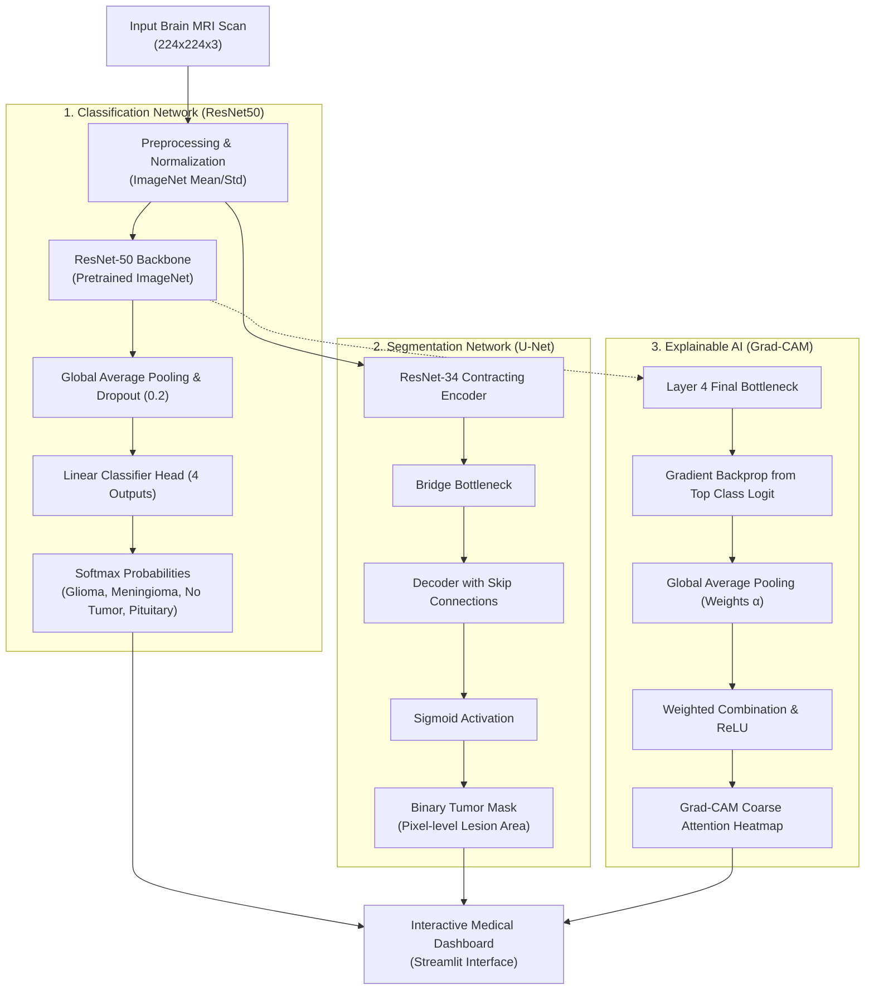

# Brain Tumor Detection, Segmentation & Explainable Diagnosis System

[](https://www.python.org/downloads/)
[](https://pytorch.org/)
[](https://opensource.org/licenses/MIT)
[](https://streamlit.io/)

A multi-task deep learning platform for **4-class Brain MRI classification**, **pixel-level tumor segmentation**, and **Grad-CAM explainable artificial intelligence (XAI)** built upon PyTorch, torchvision, and Streamlit.

---

## 1. Problem Statement

Brain tumors (including gliomas, meningiomas, and pituitary neoplasms) represent some of the most aggressive oncological conditions worldwide. Accurate early detection and spatial localization are critical for surgical resection planning, radiation therapy targeting, and prognostic assessment. 

In clinical practice, magnetic resonance imaging (MRI) is the gold standard imaging modality. However, manual radiological interpretation suffers from several key bottlenecks:
- **Radiologist Workload**: Manual volumetric delineation of complex lesions is labor-intensive and prone to inter-observer variability.
- **Subtle Differential Diagnoses**: Distinguishing between high-grade gliomas and aggressive meningiomas can be challenging on standard axial slices without specialized multi-parametric imaging.
- **The "Black Box" Barrier**: While deep convolutional neural networks achieve superhuman diagnostic accuracy, the lack of interpretability impairs clinical trust and regulatory adoption.

---

## 2. Project Objectives

1. **Four-Class Diagnostic Classification**: Automatically categorize axial brain MRI scans into four classes: **Glioma**, **Meningioma**, **No Tumor (Healthy)**, and **Pituitary**.
2. **High-Fidelity Semantic Segmentation**: Delineate exact pixel-level spatial boundaries of neoplastic tissue using an encoder-decoder U-Net architecture.
3. **Transparent Explainable AI (XAI)**: Generate visual gradient-weighted class activation heatmaps (Grad-CAM) to explain the convolutional feature attributions driving classification decisions.
4. **Clinical Demonstration Dashboard**: Deploy an interactive, responsive medical dashboard in Streamlit that visualizes classifications, probabilities, segmentation overlays, and explainability maps in real time.

---

## 3. Key Features

- **End-to-End Multi-Task Architecture**: Integrates classification, segmentation, and explainability into a unified modular framework.
- **Transfer Learning Backbone**: Leverages ImageNet-pretrained weights for both ResNet-50 (classifier) and ResNet-34 (U-Net encoder).
- **Strict Clinical Preprocessing**: Enforces nearest-neighbor interpolation on segmentation masks to eliminate edge artifacts and prevent non-binary boundary blurring.
- **Hardware-Aware Acceleration**: Automatic detection and optimization for **NVIDIA CUDA GPUs**, **Apple Silicon (MPS)**, and standard CPU workstations.
- **Interactive Streamlit UI**: Offers side-by-side MRI scans, real-time threshold adjustments, overlay transparency controls, and downloadable JSON diagnostic reports.
- **Production-Ready Code Quality**: Modular codebase with configuration-driven execution (`config.yaml`), rigorous type hints, and automated unit tests.

---

## 4. Technologies Used

- **Deep Learning Framework**: PyTorch, Torchvision, Segmentation Models PyTorch (smp)
- **Computer Vision & Processing**: OpenCV, Pillow, NumPy, Pandas
- **Explainable AI**: PyTorch Grad-CAM (with native backpropagation fallback)
- **Visualization**: Matplotlib, Seaborn
- **Evaluation & Metrics**: Scikit-Learn (Macro F1, Precision, Recall, Confusion Matrix, Dice Similarity, IoU)
- **Web Application**: Streamlit
- **Configuration & Testing**: PyYAML, Pytest, Unittest

---

## 5. Dataset Information & Access

This repository is built for benchmark evaluation on the **BRISC2025 (Brain MRI Segmentation and Classification 2025)** dataset.

- **Classes**:
  - `glioma`: Glial cell neoplasm
  - `meningioma`: Extra-axial meningeal tumor
  - `no_tumor`: Healthy control brain scan
  - `pituitary`: Sellar / parasellar pituitary adenoma
- **Modality**: Axial T1-weighted and T2-weighted MRI scans
- **Resolution**: Normalized to $224 \times 224$ pixels
- **Data Access**: Download the BRISC2025 dataset archive from your official competition or research portal and extract it into `data/brisc2025/`.

---

## 6. Dataset Folder Structure

Organize the dataset in `data/brisc2025/` following this layout:

```text
data/
└── brisc2025/
    ├── classification_task/
    │   ├── train/
    │   │   ├── glioma/
    │   │   ├── meningioma/
    │   │   ├── no_tumor/
    │   │   └── pituitary/
    │   └── test/
    │       ├── glioma/
    │       ├── meningioma/
    │       ├── no_tumor/
    │       └── pituitary/
    │
    └── segmentation_task/
        ├── train/
        │   ├── images/
        │   └── masks/
        └── test/
            ├── images/
            └── masks/
```

> **Pairing Guarantee**: If only a single segmentation folder is provided, our data loader automatically verifies filename stems and partitions the dataset deterministically into stratified train (70%), validation (15%), and test (15%) splits.

---

## 7. Architecture Diagram



---

## 8. Classification Methodology

- **Backbone**: Pretrained **ResNet-50** with 4 residual stages and bottleneck blocks.
- **Input Dimensions**: $3 \times 224 \times 224$ normalized with ImageNet statistics ($\mu = [0.485, 0.456, 0.406]$, $\sigma = [0.229, 0.224, 0.225]$).
- **Head**: 2048-dimensional linear projection with dropout ($p=0.2$) mapping to 4 diagnostic outputs.
- **Loss Function**: Cross-Entropy Loss:
  $$\mathcal{L}_{CE} = - \sum_{c=1}^4 y_c \log(\hat{y}_c)$$
- **Optimizer**: Adam ($\text{lr} = 5 \times 10^{-4}$, weight decay $= 10^{-4}$) with StepLR learning rate scheduling.
- **Evaluation Metrics**: Top-1 Accuracy, Macro Precision, Macro Recall, Macro F1-Score, and full multi-class Confusion Matrix.

---

## 9. Segmentation Methodology

- **Architecture**: **U-Net** semantic segmentation network with a **ResNet-34** encoder.
- **Skip Connections**: Bridge multi-scale feature representations from the encoder to the decoder to preserve millimeter-scale anatomical tumor boundaries.
- **Loss Function**: Hybrid Combined Loss combining Binary Cross-Entropy and Soft Dice Loss to address severe foreground-background class imbalance:
  $$\mathcal{L}_{total} = \mathcal{L}_{BCE} + \mathcal{L}_{Dice}$$
  $$\mathcal{L}_{Dice} = 1 - \frac{2 \sum_i p_i g_i + \epsilon}{\sum_i p_i + \sum_i g_i + \epsilon}$$
- **Evaluation Metrics**: Dice Similarity Coefficient (DSC), Intersection over Union (IoU / Jaccard Index), Precision, Recall, and Pixel-level Accuracy.

---

## 10. Grad-CAM Explainability

**Grad-CAM (Gradient-weighted Class Activation Mapping)** generates visual saliency maps highlighting the spatial regions that drove the ResNet-50 classifier toward its predicted tumor category:

1. Gradients of the target class logit $y^c$ are backpropagated to the final convolutional layer (`layer4[-1]`).
2. Global average pooling calculates importance weights $\alpha_k^c$ for each feature activation map $A^k$.
3. Feature maps are linearly combined and filtered through a ReLU activation:
   $$L_{\text{Grad-CAM}}^c = \text{ReLU}\left(\sum_k \alpha_k^c A^k\right)$$

> **Clinical Interpretation Notice**: Grad-CAM visualizes coarse convolutional attention (from a $7 \times 7$ grid upsampled to $224 \times 224$) and often highlights secondary contextual indicators (e.g. ventricular compression or midline shift). It is **not** an anatomical tumor boundary. Spatial boundaries are delineated independently by the U-Net segmentation network.

---

## 11. Installation Instructions

```bash
# 1. Clone the repository
git clone https://github.com/<your-username>/brain-tumor-detection-segmentation.git
cd brain-tumor-detection-segmentation

# 2. Create and activate a virtual environment
python3 -m venv .venv
source .venv/bin/activate  # On Windows: .venv\Scripts\activate

# 3. Upgrade pip and install dependencies
pip install --upgrade pip
pip install -r requirements.txt
```

---

## 12. Training Commands

Verify dataset integrity prior to training:
```bash
python -m src.data.preprocessing --verify --path data/brisc2025
```

Train the ResNet-50 Classifier:
```bash
python -m src.training.train_classifier --epochs 15 --batch-size 32 --lr 0.0005
```

Train the U-Net Segmenter:
```bash
python -m src.training.train_segmenter --epochs 20 --batch-size 16 --lr 0.0005
```

---

## 13. Evaluation Commands

Evaluate the Classifier on the independent test set:
```bash
python -m src.evaluation.evaluate_classifier \
    --checkpoint checkpoints/best_classifier.pth \
    --test-dir data/brisc2025/classification_task/test
```

Evaluate the Segmenter on the independent test set:
```bash
python -m src.evaluation.evaluate_segmenter \
    --checkpoint checkpoints/best_segmenter.pth \
    --test-images data/brisc2025/segmentation_task/test/images \
    --test-masks data/brisc2025/segmentation_task/test/masks
```

---

## 14. Streamlit Dashboard Execution

Launch the interactive medical AI web dashboard:

```bash
streamlit run app/streamlit_app.py
```

The application will start at `http://localhost:8501`. If model weights are pending training, the application operates in interactive demonstration mode with built-in synthetic benchmark scans.

---

## 15. Results & Performance Metrics

> [!NOTE]
> In accordance with scientific integrity standards, experimental metrics are recorded upon completing full training on the BRISC2025 benchmark. Results will be populated once training is executed locally or on cloud GPU infrastructure.

### Classification Test Performance (Pending Training)

| Class | Precision | Recall | F1-Score | Support |
| :--- | :---: | :---: | :---: | :---: |
| **Glioma** | *Pending* | *Pending* | *Pending* | *Pending* |
| **Meningioma** | *Pending* | *Pending* | *Pending* | *Pending* |
| **No Tumor** | *Pending* | *Pending* | *Pending* | *Pending* |
| **Pituitary** | *Pending* | *Pending* | *Pending* | *Pending* |
| **Overall Macro Avg** | *Pending* | *Pending* | *Pending* | *Pending* |

### Segmentation Test Performance (Pending Training)

| Metric | Target Benchmark | Test Result |
| :--- | :---: | :---: |
| **Dice Similarity Coefficient (DSC)** | $> 0.85$ | *Pending* |
| **Intersection over Union (IoU)** | $> 0.75$ | *Pending* |
| **Precision** | $> 0.85$ | *Pending* |
| **Recall (Sensitivity)** | $> 0.85$ | *Pending* |
| **Pixel-Level Accuracy** | $> 0.98$ | *Pending* |

---

## 16. Screenshots

Place application screenshots in `results/visualizations/` after running the Streamlit app:

| Diagnostic Dashboard View | Grad-CAM Explainability View |
| :---: | :---: |
| *Dashboard Screenshot (To be added)* | *Grad-CAM Saliency Screenshot (To be added)* |

---

## 17. Project Directory Structure

```text
brain-tumor-detection-segmentation/
├── README.md                      # Comprehensive project documentation
├── requirements.txt               # Pinned Python package dependencies
├── .gitignore                     # Git tracking exclusions
├── LICENSE                        # MIT Open Source License
├── GITHUB_UPLOAD_GUIDE.md         # Step-by-step GitHub repository publishing guide
│
├── config/
│   └── config.yaml                # Global hyperparameters & path configuration
│
├── data/
│   └── README.md                  # BRISC2025 dataset layout & setup guide
│
├── models/
│   ├── classifier.py              # ResNet50 4-class classifier
│   └── segmenter.py               # U-Net with ResNet34 encoder
│
├── src/
│   ├── __init__.py
│   ├── data/
│   │   ├── classification_dataset.py # 4-class ImageFolder & split manager
│   │   ├── segmentation_dataset.py   # Pairwise image-mask loader
│   │   └── preprocessing.py          # Nearest-neighbor mask resizing & integrity check
│   │
│   ├── training/
│   │   ├── train_classifier.py    # Classifier training loop with early stopping
│   │   └── train_segmenter.py     # Segmentation training with Combined BCE+Dice Loss
│   │
│   ├── evaluation/
│   │   ├── evaluate_classifier.py # Test set evaluation & confusion matrix
│   │   └── evaluate_segmenter.py  # Test set evaluation & sample visualizations
│   │
│   ├── explainability/
│   │   └── gradcam.py             # Native Grad-CAM backpropagation engine
│   │
│   └── utils/
│       ├── metrics.py             # Dice, IoU, F1, Precision, Recall calculations
│       ├── visualization.py       # Learning curves, confusion matrix, and overlays
│       └── seed.py                # Reproducible seeds & device auto-detection
│
├── app/
│   └── streamlit_app.py           # Polished medical AI diagnostic dashboard
│
├── notebooks/
│   ├── original/                  # Preserved baseline Jupyter notebooks
│   │   ├── 01_Dataset_Setup.ipynb
│   │   ├── 02_classification_.ipynb
│   │   └── 03_segmentation.ipynb
│   └── experiments/               # Workspace for interactive exploration
│
├── checkpoints/
│   └── README.md                  # Model weight storage guidelines
│
├── results/
│   ├── classification/            # Saved metrics, curves, and confusion matrices
│   ├── segmentation/              # Saved metrics, curves, and sample overlays
│   └── visualizations/            # Grad-CAM and composite visualizations
│
├── tests/
│   ├── test_classifier.py         # ResNet50 unit tests
│   ├── test_segmenter.py          # U-Net unit tests
│   ├── test_preprocessing.py      # Nearest-neighbor and integrity tests
│   └── test_metrics.py            # Dice, IoU, and F1 unit tests
│
└── docs/
    ├── architecture.md            # Technical specifications & mathematical formulas
    ├── dataset.md                 # BRISC2025 dataset documentation
    └── training_guide.md          # Multi-platform training instructions
```

---

## 18. Limitations

1. **2D Slice Limitations**: Analyzes single 2D axial MRI slices rather than full 3D volumetric MRI sequences (such as 3D T1-CE, T2-FLAIR, and ADC maps).
2. **Resolution Downsampling**: Resizing images from native acquisition resolutions to $224 \times 224$ pixels reduces fine-grained micro-lesion visual detail.
3. **Grad-CAM Coarseness**: Gradient heatmaps originate from a $7 \times 7$ spatial grid; while helpful for checking model attention, they lack pixel-level boundaries.

---

## 19. Future Improvements

- [ ] Incorporate multi-sequence MRI inputs (T1, T1-contrast, T2, FLAIR) using 3D U-Net architectures.
- [ ] Implement Test-Time Augmentation (TTA) and Monte Carlo Dropout for epistemic uncertainty estimation.
- [ ] Export trained checkpoints to ONNX and TensorRT for low-latency clinical edge deployment.
- [ ] Integrate integrated gradients and SHAP for multi-method explainability comparisons.

---

## 20. Academic & Clinical Disclaimer

> [!CAUTION]
> This software is an **academic research prototype** intended solely for educational demonstration, scientific inquiry, and algorithmic benchmarking. It is **NOT** a medical diagnostic device, has not received regulatory clearance (FDA, CE, or equivalent), and must **NEVER** be used to guide clinical patient diagnosis, triage, surgical planning, or therapy.

---

## 21. License

This project is licensed under the **MIT License** - see the [LICENSE](LICENSE) file for details.
