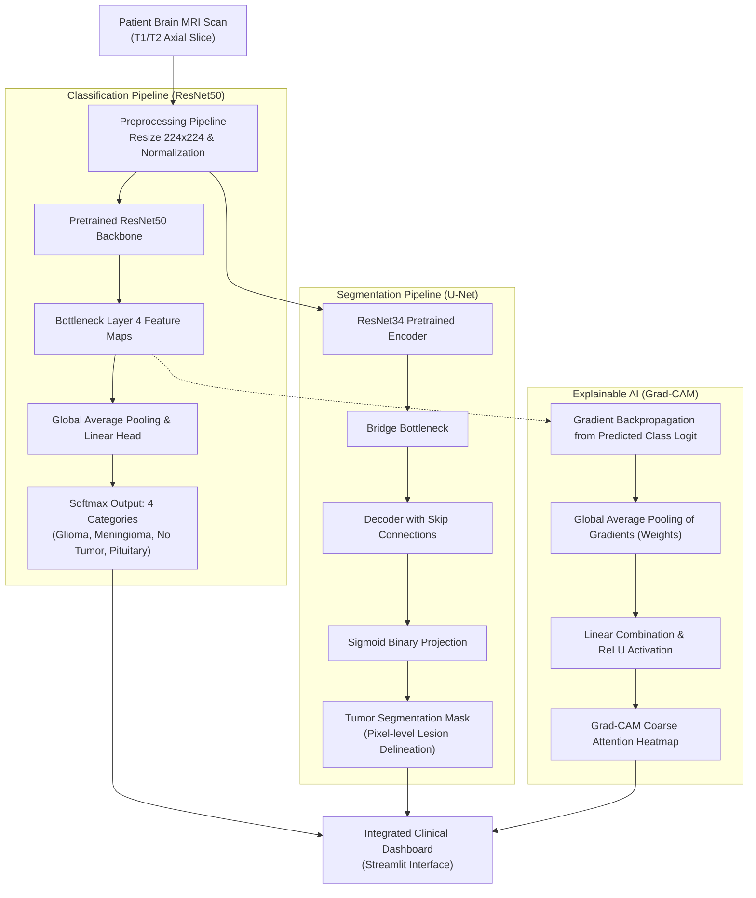

# System Architecture & Technical Specifications

This document provides a comprehensive technical overview of the **Brain Tumor Detection, Segmentation & Explainable Diagnosis System**.

---

## 1. High-Level Architectural Pipeline



---

## 2. Classification Architecture: ResNet-50

### 2.1 Model Backbone & Transfer Learning
The classification module employs **ResNet-50** (Residual Network with 50 layers), pretrained on the ImageNet-1K benchmark dataset:
- **Residual Learning**: Formulated around identity shortcut connections that mitigate the vanishing gradient problem in deep convolutional networks:
  $$\mathbf{y} = \mathcal{F}(\mathbf{x}, \{W_i\}) + \mathbf{x}$$
- **Feature Extraction**: Consists of 4 consecutive residual stages (`layer1` through `layer4`), progressively downsampling spatial resolution while expanding semantic feature representation from 64 to 2,048 channels.

### 2.2 Classification Head Adaptation
The original 1,000-class ImageNet fully connected layer is severed and replaced by a customized domain-specific head:
```python
self.backbone.fc = nn.Sequential(
    nn.Dropout(p=0.2),
    nn.Linear(in_features=2048, out_features=4),
)
```
- **Categories**:
  1. `glioma` (Index 0)
  2. `meningioma` (Index 1)
  3. `no_tumor` (Index 2)
  4. `pituitary` (Index 3)

### 2.3 Optimization & Loss Function
- **Criterion**: Categorical Cross-Entropy Loss:
  $$\mathcal{L}_{CE} = - \sum_{c=1}^{4} y_c \log(\hat{y}_c)$$
- **Optimizer**: Adam ($\beta_1=0.9, \beta_2=0.999$, weight decay $= 10^{-4}$).
- **Learning Rate Schedule**: StepLR with decay factor $\gamma=0.5$ every 5 epochs.

---

## 3. Semantic Segmentation Architecture: U-Net (ResNet-34 Encoder)

### 3.1 Encoder-Decoder with Skip Connections
The segmentation module utilizes a **U-Net** architecture paired with a pretrained **ResNet-34** contracting path:
- **Encoder (Contracting Path)**: Captures multi-scale contextual features from the MRI scan through hierarchical convolutions and pooling. Pre-initialized with ImageNet weights to accelerate boundary recognition.
- **Skip Connections**: Concatenate high-resolution spatial feature maps directly from encoder stages into corresponding decoder stages. This prevents loss of fine-grained spatial localization crucial for millimeter-level tumor boundary demarcation.
- **Decoder (Expansive Path)**: Progressively upsamples feature maps via transposed convolutions to reconstruct the original $224 \times 224$ input resolution.

### 3.2 Dual Combined Loss Formulation
Standard binary cross-entropy (BCE) struggles with medical image segmentation due to extreme class imbalance (tumor tissue often occupies $<5\%$ of total brain pixels). We implement a **Hybrid Combined Loss**:
$$\mathcal{L}_{total} = \mathcal{L}_{BCE} + \mathcal{L}_{Dice}$$

Where **Soft Dice Loss** directly maximizes the spatial overlap between predicted continuous probabilities $p_i$ and ground-truth binary mask $g_i$:
$$\mathcal{L}_{Dice} = 1 - \frac{2 \sum_i p_i g_i + \epsilon}{\sum_i p_i + \sum_i g_i + \epsilon}$$

---

## 4. Explainable AI: Grad-CAM Formulation

### 4.1 Mathematical Foundations
**Grad-CAM** (Gradient-weighted Class Activation Mapping) produces coarse 2D attribution heatmaps indicating the visual features that influenced the classification decision:

1. **Gradient Computation**: Compute the gradient of the unnormalized score (logit) $y^c$ for class $c$ with respect to feature activation map $A^k$ of the final convolutional layer:
   $$\frac{\partial y^c}{\partial A^k}$$

2. **Neuron Importance Weights ($\alpha_k^c$)**: Apply Global Average Pooling over spatial dimensions (height $H$, width $W$):
   $$\alpha_k^c = \frac{1}{Z} \sum_{i=1}^H \sum_{j=1}^W \frac{\partial y^c}{\partial A_{i, j}^k}$$

3. **Weighted Combination & Rectification**: Compute a weighted sum of forward activation maps and apply ReLU to isolate features with a strictly positive correlation to the target class:
   $$L_{\text{Grad-CAM}}^c = \text{ReLU}\left(\sum_k \alpha_k^c A^k\right)$$

### 4.2 Clinical Distinction: Grad-CAM vs U-Net Segmentation

| Metric / Dimension | Grad-CAM Attribution | U-Net Semantic Segmentation |
| :--- | :--- | :--- |
| **Origin Layer** | ResNet50 `layer4[-1]` (Coarse $7\times 7$ grid) | Multi-scale full decoder ($224 \times 224$ resolution) |
| **Objective** | Explain *why* a classification was made | Delineate *where* lesion tissue boundaries physically exist |
| **Included Features** | Primary lesion + contextual cues (edema, shift) | Exclusively segmented tumor parenchyma |
| **Surgical Utility** | Informative for trust verification | Direct spatial mask for volumetric estimation |

---

## 5. Hardware & Runtime Acceleration

The codebase automatically probes and configures hardware acceleration:
1. **NVIDIA CUDA**: Activated automatically when CUDA drivers are detected.
2. **Apple Silicon MPS (Metal Performance Shaders)**: Utilized on Apple Silicon (M1/M2/M3/M4) Macs for GPU-accelerated tensor math.
3. **CPU Fallback**: Standard float32 CPU execution ensures portability across continuous integration runners and standard workstations.
